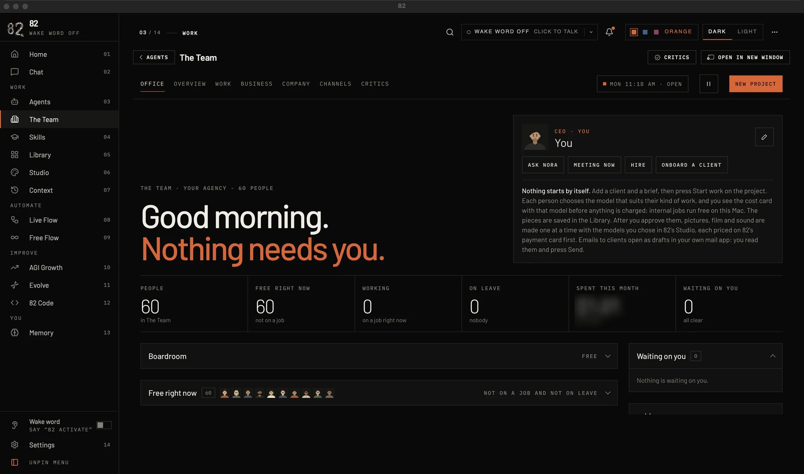
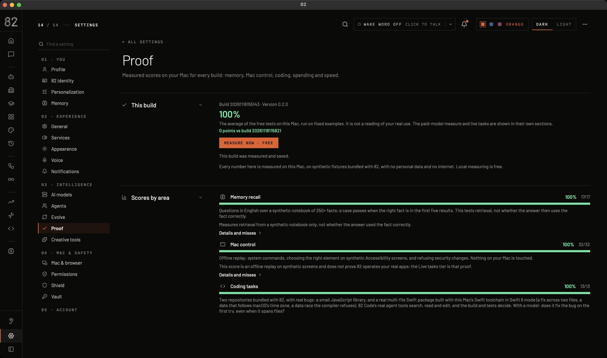
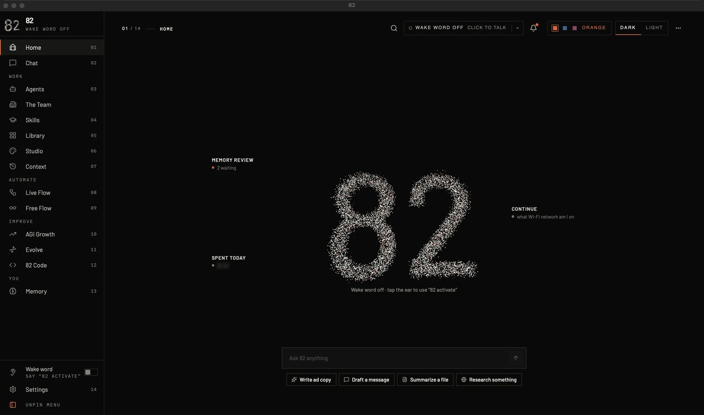

  

<h1 align="center">82</h1>

<b>You'll be hearing this number a lot.</b>

  The first livelligence. It lives on your Mac, knows you, works for you, heals itself, and keeps evolving. 
  A whole creative agency inside it. Over 1,020,000 lines of Swift, built by one creator. Two words wake it up.

  <a href="https://meet82.com/access"><b>The waiting list is open. Get on it before everyone else does →</b></a>

⭐ Star this repo to keep 82 on your radar · Watch it to hear the news first

Not an app. Not an agent. Not a chatbot.

---

## Stop working for your AI.

Today's AI hands you a piece of the job and leaves you the rest. You write the prompts, explain yourself again, copy between apps, check whether it really finished, and watch the bill.

**82 takes the rest.** You say what you want and say yes. It does the work, checks it, remembers it, and keeps your money and your Mac safe.

## Five signs of life

1. **It remembers.** Not a chat history. A memory, in clear sections: you, your work, your clients, your projects. What it infers waits for your yes.
2. **It learns.** Do a task once while it watches, and it becomes a skill. It tells your taste from your client's.
3. **It acts.** It opens apps, clicks, types, browses, cuts video, builds sites and writes code, then checks the screen before it says "done".
4. **It never sleeps.** Close the window and schedules, agents, WhatsApp and voice keep running. Restart the Mac and it comes back.
5. **It heals and grows.** Evolve finds what is broken and proves the fix before it installs. Every version must beat the last one, or it doesn't ship.

## Built in.

- **Director Mode in the Studio.** Tiles above the prompt for camera, move, light, colour, lens and story, and for music, voice and sound effects. Every choice has a sample made on your Mac and a badge for how surely the chosen model follows it. Two versions side by side, or a storyboard of up to six shots, with every price shown before anything is sent.
- **Sites & Apps, built by eye.** Site fonts, a Site Director for style, colours, fonts and spacing, videos and sandboxed embeds. A text or picture change you make yourself is saved straight into the site, free, and checked on the page.
- **Big photos, full quality.** A photo longer than 4,096 pixels is edited on a light working copy and saved at full size.
- **82 Code.** An agent board that runs 82's own agent beside the coding agents you install. Package updates stay inside your version ranges and are undone if the project's own check fails, and one card names the commits and files before anything is pushed.
- **82 writes the prompt.** Type a brief in your own words. The Brief Engine adds light, lens, colour, camera and sound in the grammar the chosen model reads, free, on your Mac, and every added line says why. Your words come first, exactly as typed.
- **Elements and Identity Lock.** People, places, products, props and voices in one list every studio reads. Write @name in a brief to bring one in. Each new picture of a person is checked against their face on your Mac.
- **See it first, then pay.** Your own picture relit and graded on your Mac for free, then a cheap draft at its real price, then the final on its own card.
- **Looks and design autopilot.** A brand kit, a moodboard or a picture becomes a look used in every studio. One design is set in 12 sizes and every size is checked against the rules. Sites & Apps has 20 original site looks, Arabic first.
- **A client's master, locked.** Enter a client's brand guideline once. Every new post keeps the layout, fonts, colours and logo rules, only the content changes, and a live preview shows it as you type.
- **AI blocks on the timeline.** Grade, reframe, steady, slow motion, cut out and remove sit on their own lane, free on your Mac. Scribble over something to remove it, even when the camera moves. Paid changes show their price first.
- **The whole job, one card.** The Team turns one brief into concept, shots, pictures, film, voice, music, edit, sizes and export, planned free on your Mac and approved on one price card.
- **Free on your Mac.** Sharper, Cut out, Select, Fill and Smooth, and 82 Offline Image: a picture made on your Mac with no key and no account. Each model is downloaded once.
- **Dictate anywhere.** Hold Globe in any Mac app, speak, and your words land at the cursor. Hold Shift too and English becomes Arabic, or Arabic becomes English.
- **82 Smarter.** An optional 9B chat model on your Mac that answers better, at about half the speed of the default one.

## A whole agency, in one window.

Sixty people in twelve departments, and ten critics who only say what will fail. Give them a brief, see the cost, and say yes. You take the corner office.

The agency desk keeps a rate card, billable time, retainers, quotes and invoices with tax, and shows the profit of every project and client. A reply to a client leaves only after you approve its exact words.

## Measured, not promised.

Tests bundled inside 82, run on the published build. The weakest score is published too.

| Area | Score |
| --- | --- |
| Memory recall | 17 / 17 |
| Understanding | 211 / 211 |
| Mac control | 32 / 32 |
| Coding tasks | 13 / 13 |
| Spend gate | 22 / 22 |
| Latency | 6 / 6 |

The weakest score: Apple's free on-device model alone heard 2 of 4 test phrases exactly and solved 1 of 7 coding tasks on this build.

Build `20261121135055` · v0.2.0 · 452 release checks passed · measured 21 November 2026. Every test and every score: **[meet82.com/proof](https://meet82.com/proof)**

## Yours, on your Mac.

Your memory, files, chats and keys live on your machine. No 82 account, and no 82 server holding them.

82 is free. Your AI provider is paid directly, with no markup, and every paid step waits for your yes.

Signed and notarized by Apple · Developer ID `N5BW9X8L3X`

## In private preview.

You won't find code or an app in this repository. 82 opens to a small circle at a time, through the waiting list.

**[Request access at meet82.com →](https://meet82.com/access)**

⭐ Star this repo to keep 82 on your radar.

Apple silicon (M1 or later) · macOS 14 or later · 1.5 GB

  <a href="https://meet82.com">meet82.com</a> ·
  <a href="https://meet82.com/how-it-works">How it works</a> ·
  <a href="https://meet82.com/the-team">The Team</a> ·
  <a href="https://meet82.com/proof">Proof</a> ·
  <a href="https://meet82.com/about">About</a>

© 2026 Mohd Yaser Siksik. All rights reserved.

