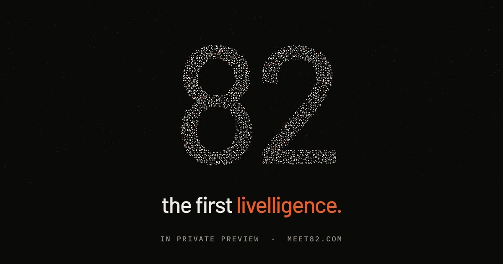

  

<h1 align="center">82</h1>

<b>You'll be hearing this number a lot.</b>

  The first livelligence. It lives on your Mac, knows you, works for you, heals itself, and keeps evolving. 
  A whole creative agency inside it. Over 900,000 lines of Swift, built by one creator. Two words wake it up.

  <a href="https://meet82.com/access"><b>The list is open. Get on it before everyone else does →</b></a>

Not an app. Not an agent. Not a chatbot.

---

## Stop working for your AI.

Today's AI hands you a piece of the job and leaves you the rest. You write the prompts, explain yourself again, copy between apps, check whether it really finished, and watch the bill.

**82 takes the rest.** You say what you want and say yes. It does the work, checks it, remembers it, and keeps your money and your Mac safe.

## Five signs of life

1. **It remembers.** Not a chat history. A memory, in clear sections: you, your work, your clients, your projects. What it infers waits for your yes.
2. **It learns.** Do a task once while it watches, and it becomes a skill. It tells your taste from your client's.
3. **It acts.** It opens apps, clicks, types, browses, cuts video, builds sites and writes code, then checks the screen before it says "done".
4. **It never sleeps.** Close the window and schedules, agents, WhatsApp and voice keep running. Restart the Mac and it comes back.
5. **It heals and grows.** Evolve finds what is broken and proves the fix before it installs. Every version must beat the last one, or it doesn't ship.

## A whole agency, in one window.

Sixty people in twelve departments, and ten critics who only say what will fail. Give them a brief, see the cost, and say yes. You take the corner office.

## Measured, not promised.

Tests bundled inside 82, run on the published build. The weakest score is published too.

| Area | Score |
| --- | --- |
| Memory recall | 17 / 17 |
| Understanding | 211 / 211 |
| Mac control | 32 / 32 |
| Coding tasks | 13 / 13 |
| Spend gate | 22 / 22 |
| Latency | 6 / 6 |

The weakest score: Apple's free on-device model alone heard 2 of 4 test phrases exactly and solved 1 of 7 coding tasks on this build.

Build `20261116155143` · v0.2.0 · 450 release checks passed · measured 16 November 2026. Every test and every score: **[meet82.com/proof](https://meet82.com/proof)**

## Yours, on your Mac.

Your memory, files, chats and keys live on your machine. No 82 account, and no 82 server holding them.

82 is free. Your AI provider is paid directly, with no markup, and every paid step waits for your yes.

Signed and notarized by Apple · Developer ID `N5BW9X8L3X`

## In private preview.

You won't find code or an app in this repository. 82 opens to a small circle at a time, through the waiting list.

**[Request access at meet82.com →](https://meet82.com/access)**

Apple silicon (M1 or later) · macOS 14 or later · 1.5 GB

  <a href="https://meet82.com">meet82.com</a> ·
  <a href="https://meet82.com/how-it-works">How it works</a> ·
  <a href="https://meet82.com/the-team">The Team</a> ·
  <a href="https://meet82.com/proof">Proof</a> ·
  <a href="https://meet82.com/about">About</a>

© 2026 Mohd Yaser Siksik. All rights reserved.

